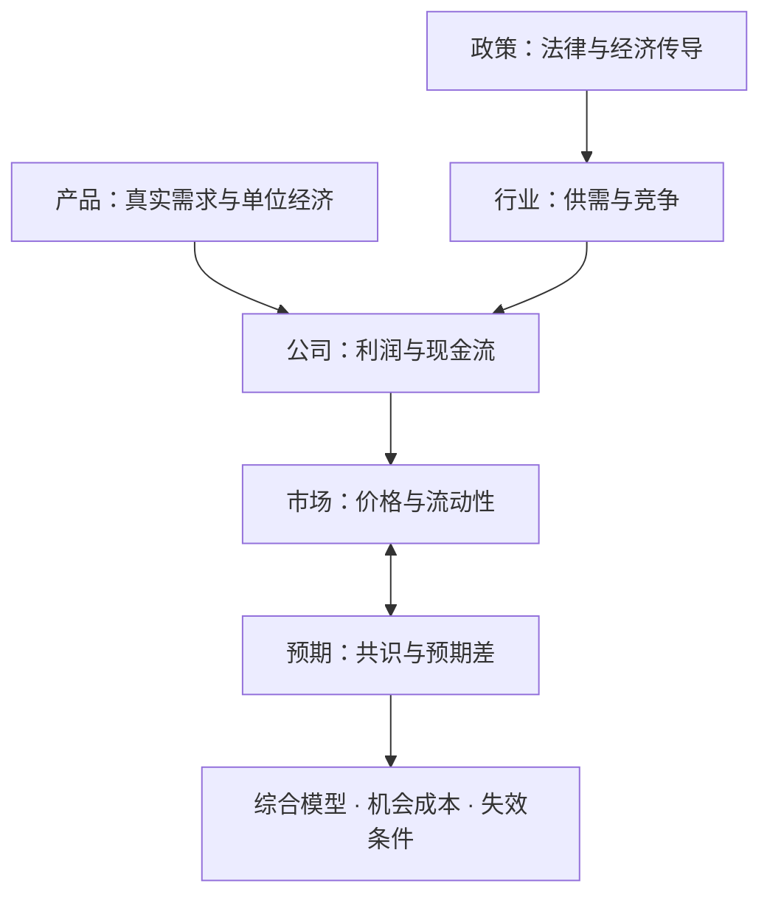

<div align="center">


# ANALYZE

**穿透式金融与商业研究 · Evidence-driven research for AI agents**

[](SKILL.md)
[](scripts/)
[](scripts/)
[](LICENSE)

`$analyze` — 从原始证据走到独立决策。

</div>

## 它是做什么的？

ANALYZE 是一个面向投资研究、创业调查与金融市场分析的 AI Agent Skill。它将行业、公司、产品、政策、市场和预期六个研究领域连成完整的研究链：发现异常 → 解读指标 → 追踪原始资料 → 解释经济机制 → 建立模型 → 反证 → 形成可更新的判断。

与单纯搜集资讯不同，它要求研究股票时理解产品的真实用户、产业竞争与利润池、政策约束、企业现金流，以及当前价格已经计入的预期。对于加密、量化或事件研究，要求检查市场结构、统计有效性、交易成本与实际执行约束。

ANALYZE turns an agent into a disciplined research assistant for companies, products, industries, policy, markets and expectations. It links primary evidence to business mechanisms, reproducible calculations, counterarguments and decision conditions through an eight-stage gate.

## 快速开始

**安装为 Codex Skill**（全局，任选一种命令环境）：

Windows PowerShell：
```powershell
New-Item -ItemType Directory -Force "$HOME\.agents\skills" | Out-Null
git clone https://github.com/xuqinghuan675/analyze-skill.git "$HOME\.agents\skills\analyze"
```

macOS / Linux：
```bash
mkdir -p ~/.agents/skills
git clone https://github.com/xuqinghuan675/analyze-skill.git ~/.agents/skills/analyze
```

开启新的 Codex 会话，输入：

```text
$analyze 研究英伟达：产品、产业链、财务与当前估值是否匹配。
```

也支持任何能读取本地文件并运行 Python 的 Agent。直接指定仓库中的 [SKILL.md](SKILL.md)，即可加载完整研究流程。核心检查器与计算工具仅需 Python 3.10+ 标准库；在线检索由所使用 Agent 的可用工具承担。可选的字幕工具另需依赖，见 [字幕规程](references/video/caption-workflow.md)。

## 集成的研究思想与方法

| 来源 | 融合的能力 |
|---|---|
| 老周横眉、小Lin说、Asianometry、Patrick Boyle | 异常指标追问、货币与信用、技术产业链、市场制度 |
| Warren Buffett、Howard Marks、Michael Mauboussin、Aswath Damodaran | 所有者收益、资本配置、风险周期、经济利润、护城河、反向估值 |
| Amazon 股东信、Stratechery、Bill Gurley、Acquired、Business Breakdowns | 用户价值、平台经济、商业模式、长期投入与企业历史 |
| Ben Felix、Rational Reminder、CFA Institute、AQR | 实证投资、机会成本、风险与尽职研究、多重检验 |
| Anthropic Financial Services、Stanford STORM、FinanceBench、FinQA | 分阶段研究、竞争解释、证据绑定、可复算金融计算 |
| EdgarTools、DoWhy、Qlib、ARCH、hftbacktest、QuantLib、DeFiLlama | 财报提取、因果推断、统计验证、订单簿模拟、金融定价与链上指标 |

完整来源及阅读边界见 [多源知识地图](references/knowledge/source-atlas.md)、[专家学习档案](references/expert-learning.md)、[工作流参考](references/workflow-method-sources.md)。本项目是独立的综合研究方法，不是上述作者/机构的官方产品；开源项目作为方法参考，没有将它们整体打包或视作已验证投资策略。

## 六域联动 · 八关验收



- G0 研究契约 → G1 原始证据 → G2 指标解码 → G3 竞争解释 → G4 穿透调查 → G5 模型与情景 → G6 反证 → G7 决策交付。
- 31个证据主题、24项专项成果、6条跨域链接。每关保存实际成果；检查器会校验引用关系、研究截点、数值复算、文件哈希及联动依赖。
- COMPLETE、PARTIAL、IN_PROGRESS、BLOCKED、STALE 明确区分研究进度及缺口。流程通过不是盈利保证或事实认证。

## 内容

| 入口 | 用途 |
|---|---|
| [SKILL.md](SKILL.md) | 简洁 Skill 入口 |
| [WORKFLOW.md](WORKFLOW.md) · [WORKFLOW_SCHEMA.md](WORKFLOW_SCHEMA.md) | 强制研究规程和结构字段 |
| [references/playbooks/](references/playbooks/) | 6类研究手册 |
| [references/specialists/](references/specialists/) | 17份专业手册，涵盖金融、宏观、行业、产品、法律、统计及加密 |
| [references/knowledge/](references/knowledge/) | 55条本轮精选来源登记、专题路由与多源取证 |
| [references/cases/](references/cases/) | Costco、ASML、SVB 的历史财报局部算例 |
| [scripts/](scripts/) | 验收器、联动检查、信源路由、金融公式与77项程序测试 |

## 命令行（仓库根目录）

```bash
python scripts/research_gate.py init example --routes company
python scripts/source_plan.py --routes company --focus valuation,technology
python scripts/research_gate.py status example
# Agent 填写每个阶段实际产物后逐关推进
python scripts/research_gate.py advance example
python scripts/research_gate.py verify example
python -m unittest discover -s scripts -p "test_*.py"
```

研究结果保存在 `research/`；本地研究资料、依赖、完整第三方字幕和媒体不纳入公开仓库。历史案例只演示局部计算与机制，不是全关研究或当前投资建议。

**Version 6.0** · Knowledge V6 / Gate schema V5 · MIT（原创代码与说明，第三方资料仍归各自权利人）
